# Decocraft Storefront

A coordinated set of 16 Decocraft storefront Markdown previews, including compact clickable pack title bars and individual pack pages.

**Status:** Working preview. The title banners below are compact SVG prototypes. The image-generated Minecraft-style banner artwork has not yet been uploaded to GitHub, and the pack page key art currently remains the existing SVG concept artwork. Dependencies, pack contents, and publication links need verification.

## Pack collection

[Open the main hub page](hub/README.md)

<a href="packs/megapack.md">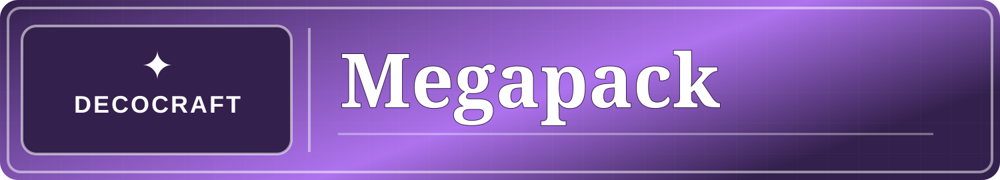</a>

<a href="packs/cottage-core.md">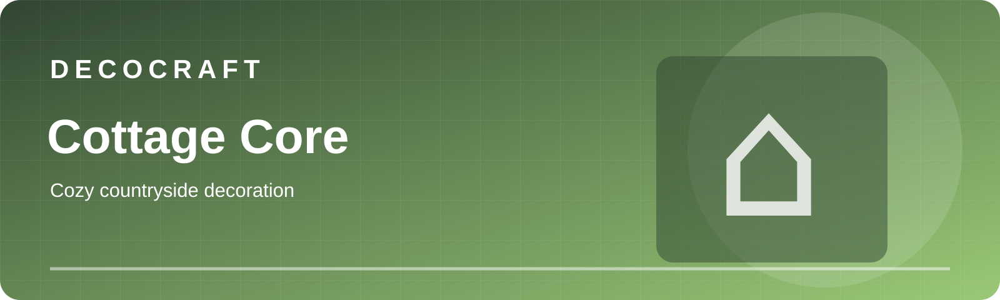</a>

<a href="packs/decopops.md">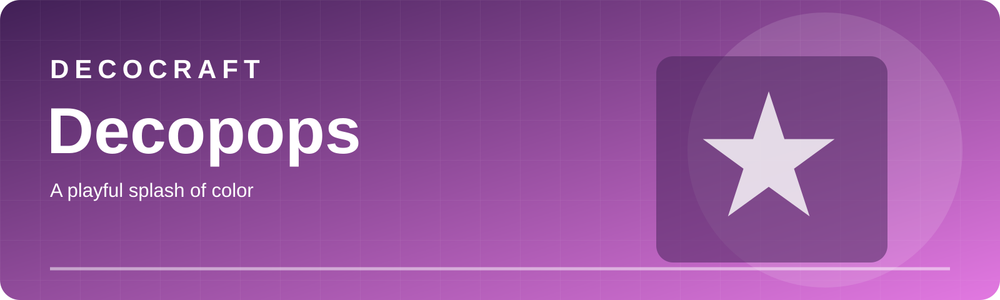</a>

<a href="packs/hobbies.md">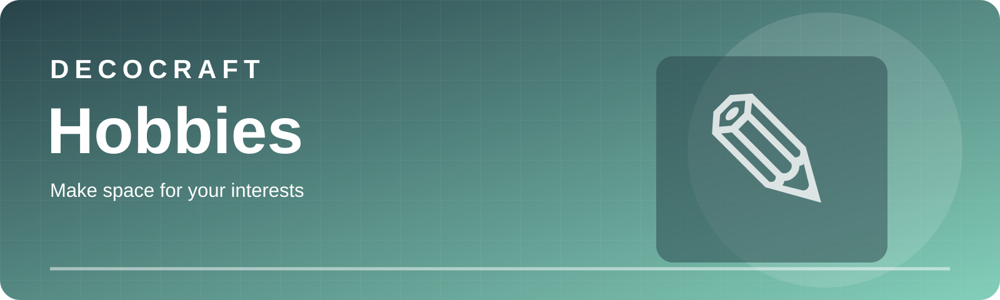</a>

<a href="packs/kids.md">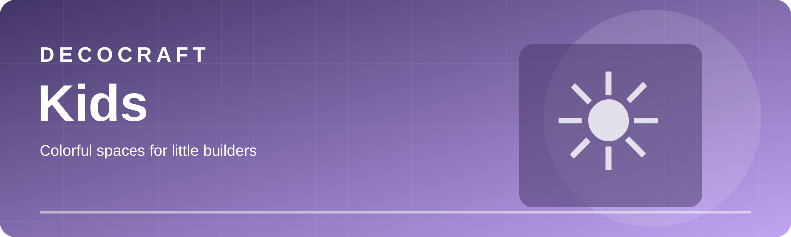</a>

<a href="packs/lighting.md">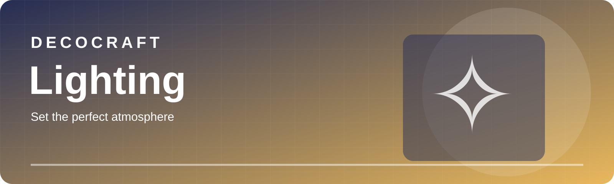</a>

<a href="packs/medieval.md">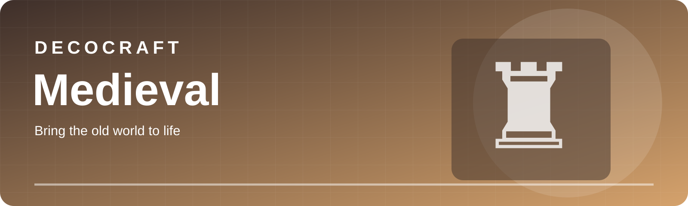</a>

<a href="packs/paintings.md">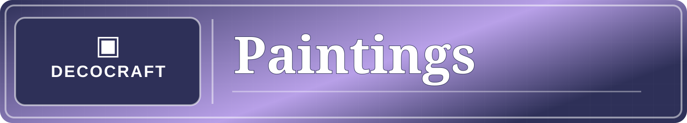</a>

<a href="packs/seasons.md">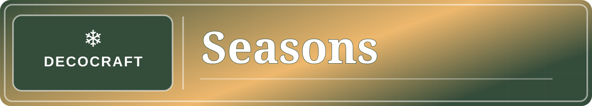</a>

<a href="packs/vehicles.md">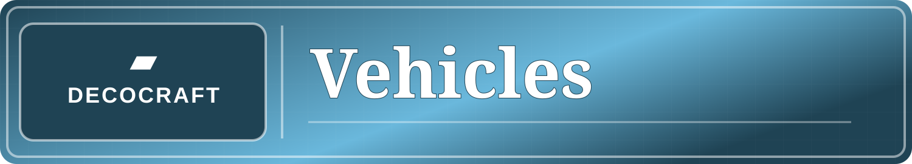</a>

<a href="packs/world-flags.md">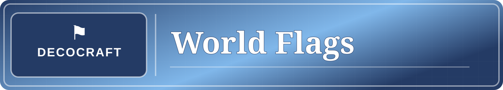</a>

## Project layout

- `hub/README.md` — main page with compact, clickable pack buttons
- `packs/*.md` — 16 individual page drafts with key art, social panels, description, dependencies, and hub return
- `assets/<pack>/banner.svg` — compact horizontal title buttons (1500 × 270)
- `assets/<pack>/keyart.svg` — existing concept art, pending generated raster replacements
- `assets/<pack>/social-*.svg` — social panels
- `assets/shared/back-to-decocraft.svg` — return-to-hub link graphic

## Before publishing

Confirm exact dependencies and supported loader/version combinations; replace placeholder social and pack URLs; replace concept artwork with final art; use public absolute HTTPS image URLs on third-party storefronts.
