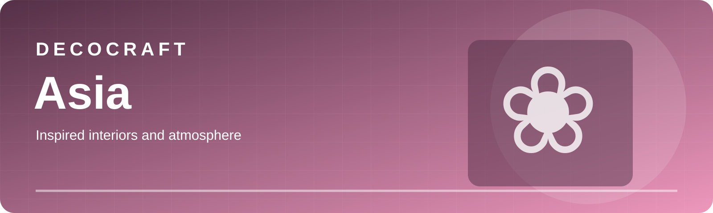
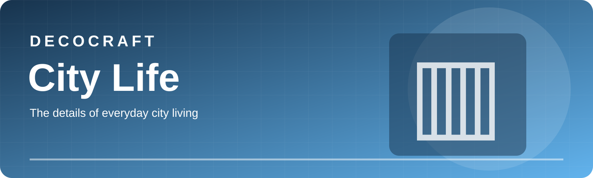
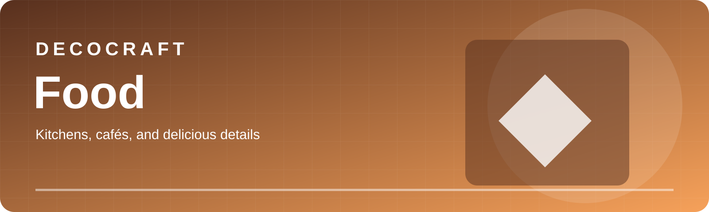
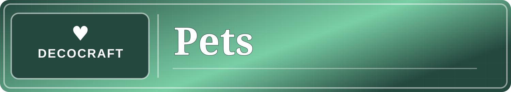
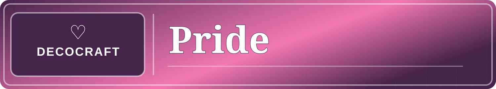

# Decocraft Storefront

A coordinated set of **16 Decocraft storefront Markdown drafts** and themed vector concept graphics for Modrinth and CurseForge.

> **Draft:** Descriptions and artwork are preliminary; actual items, release metadata and dependencies must be confirmed before publication.

## Preview the collection

[View the hub page](hub/README.md)

## Layout

- `hub/README.md` — central Decocraft pack hub
- `packs/*.md` — individual pack storefront templates
- `assets/<pack>/banner.svg` — themed hub navigation banners
- `assets/<pack>/keyart.svg` — themed pack art
- `assets/<pack>/social-*.svg` — Discord, Modrinth and CurseForge panels
- `assets/shared/back-to-decocraft.svg` — shared return panel

## Publishing notes

1. Confirm actual contents and avoid claiming unverified item features.
2. Replace `REPLACE_ME` social and pack URLs.
3. Confirm loader, Minecraft version, required base/core and exact dependencies separately for each pack.
4. Review SVG concept assets and export production PNGs or replace with rendered art when appropriate.
5. Host images at public HTTPS URLs; repository-relative Markdown images are not reliably supported on external storefronts.
6. Replace internal hub links with the real Modrinth and CurseForge pages.

The graphics are editable vector **concept assets** rather than in-game screenshots or final image-generation key art.
