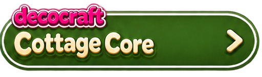
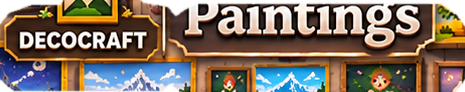
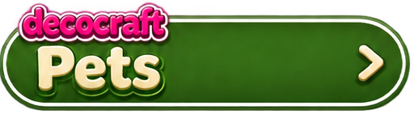
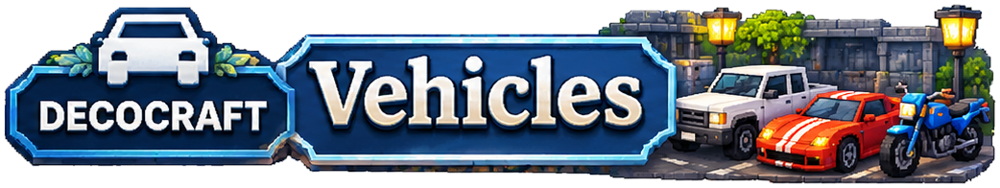

  
  
  

**Bring your Minecraft builds to life with thousands of decorations, furniture pieces, and animated details.**

[Decocraft on Modrinth](https://modrinth.com/mod/decocraft) · [Decocraft on CurseForge](https://www.curseforge.com/minecraft/mc-mods/decocraft)

> **A new chapter for Decocraft:** Decocraft is being organized into themed packs so you can explore the styles that best suit your builds. The pack pages below are previews for upcoming releases. Individual compatibility and dependencies will be announced with each release.

> **Legacy version notes:** For Decocraft 1.16 and later, PTRLib is not required; the historical 1.12.2 release requires it. The original 1.16 release was identified as beta. These older notes do **not** establish dependencies for the upcoming modular packs.

## 📚 About

Decocraft brings a huge range of decoration options to Minecraft, making it easier to transform an empty build into a welcoming, personalized space. With furniture, decorative blocks, lighting, and many other details to choose from, you can create everything from cozy cottages to elaborate fantasy and urban environments.

Some Decocraft decorations do more than sit on a shelf: certain objects are interactive or animated, adding life and personality to the places you build. Whether you're decorating a lived-in kitchen, crafting a lively town, or furnishing your dream home, Decocraft is all about the finishing touches.

As the collection expands into smaller themed packs, you'll be able to discover decorations by category and build around the themes you enjoy most.

## 🧩 Explore the Decocraft Packs

**Choose a pack to view its page.** These banners currently link to the GitHub preview for each pack. Replace those destinations with the public Modrinth pack pages after publication.

### Getting started with modular Decocraft

The pack collection is being prepared for release. Each pack page will describe its supported Minecraft versions, mod loaders, required base components, and other dependencies once those details are verified. **Do not assume that requirements from older all-in-one Decocraft versions apply to the modular packs.**

## 💬 Join us on Discord!

Follow Decocraft's community channels for news, build inspiration, and release updates. **Official Discord invite URL: to be added.**

### Credits

- **ProfMobius** — Lead Coder
- **RazzleberryFox** — 3D Models / Coder
- **PhiiDelity** — Social Media Manager
- **Momoko** — 3D Models / Coder
- **CiciHoneyBee** — 3D Models

## Check Out Our Other Mods!

Explore the creator's other projects and future announcements through the official Decocraft community and storefront profiles. Links to individual projects can be added here once confirmed.

## ❓ FAQ

**Q: Why are there separate packs now?**

A: Decocraft is being organized into smaller themed collections. Browse the pack banners above to find the styles that interest you.

**Q: Do I need a base mod or extra dependencies?**

A: Requirements are release-specific and have not yet been confirmed for all upcoming packs. Follow each pack's published dependency information when installing.

**Q: My game takes a long time to load or crashes. What should I try?**

A: Make sure your Minecraft version and loader match the mod files you installed, verify the required dependencies, and check your available memory. The existing Decocraft page historically recommended allocating at least 4 GB of RAM; actual needs vary by installation and modpack.

**Q: Can I include Decocraft in a modpack?**

A: The existing Decocraft FAQ allows use in modpacks. Check the applicable project license and current distribution rules before redistributing mod files.

---

*Storefront publishing draft. Pack links currently lead to GitHub previews; replace them with public listing URLs once the packs are live.*
