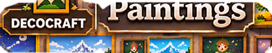
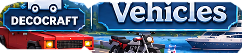

# Decocraft — Explore the Collection

Decocraft is growing into a collection of smaller themed decoration packs. Select a title below to preview its storefront page.

## Browse the packs

## Installation and compatibility

Decocraft pack dependencies and supported loaders/versions must be confirmed for each release. Refer to the technical information on each pack's published page before installing.

[Decocraft on Modrinth](https://modrinth.com/mod/decocraft) · [Decocraft on CurseForge](https://www.curseforge.com/minecraft/mc-mods/decocraft)

*GitHub preview links go to local template pages. Replace them with real pack URLs before publishing to Modrinth and CurseForge.*
