# Decocraft: Explore the Collection

Decocraft is evolving into a modular collection of themed decoration packs. Find your favorites below and personalize your Minecraft world.

## Browse all 16 packs

[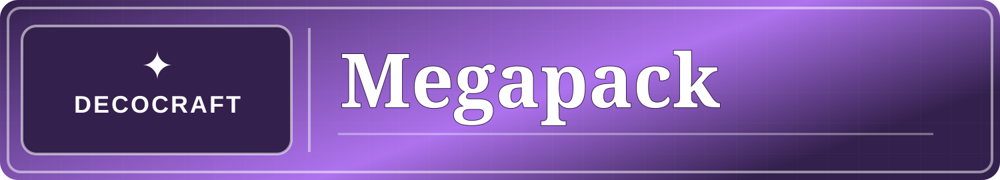](../packs/megapack.md)

**Megapack** — All the details, all in one place

[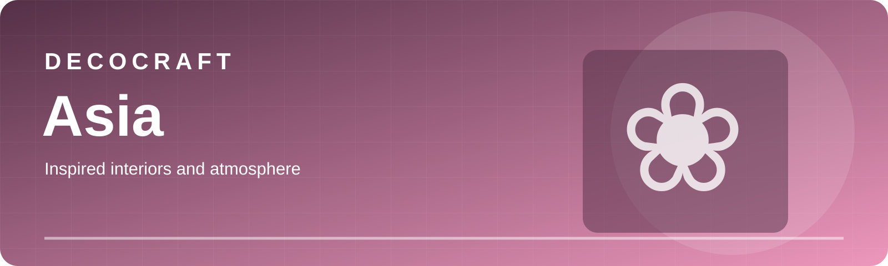](../packs/asia.md)

**Asia** — Inspired interiors and atmosphere

[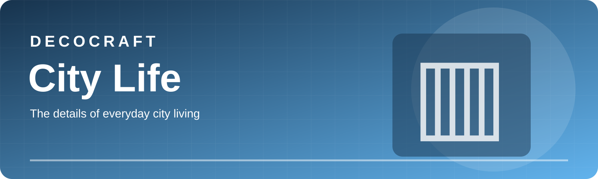](../packs/city-life.md)

**City Life** — The details of everyday city living

[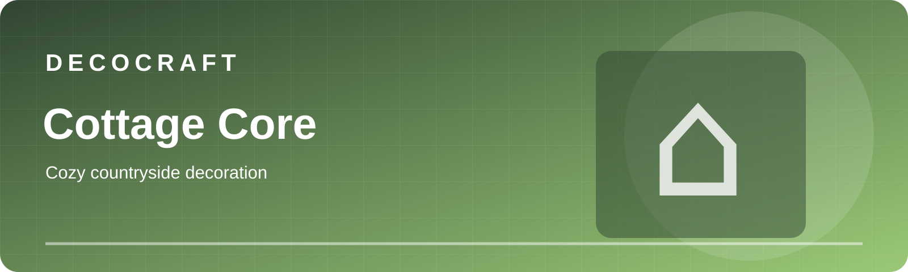](../packs/cottage-core.md)

**Cottage Core** — Cozy countryside decoration

[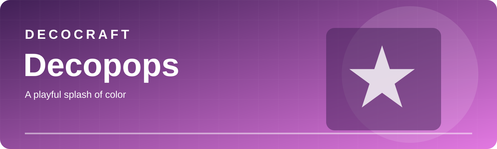](../packs/decopops.md)

**Decopops** — A playful splash of color

[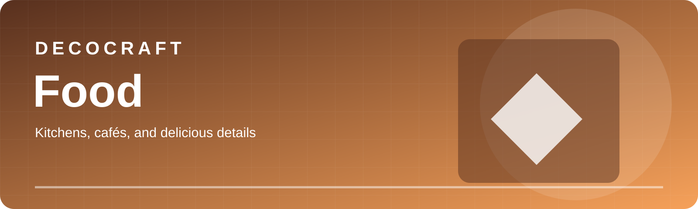](../packs/food.md)

**Food** — Kitchens, cafés, and delicious details

[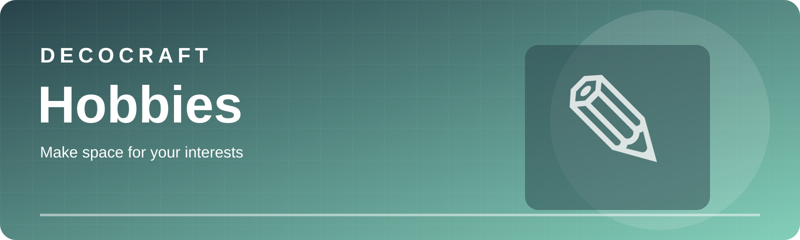](../packs/hobbies.md)

**Hobbies** — Make space for your interests

[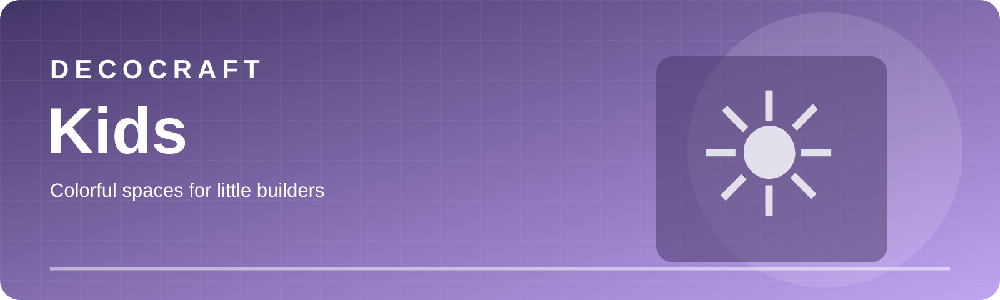](../packs/kids.md)

**Kids** — Colorful spaces for little builders

[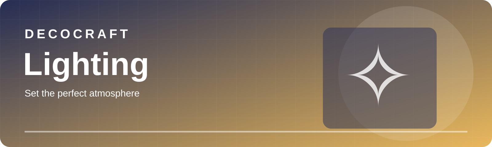](../packs/lighting.md)

**Lighting** — Set the perfect atmosphere

[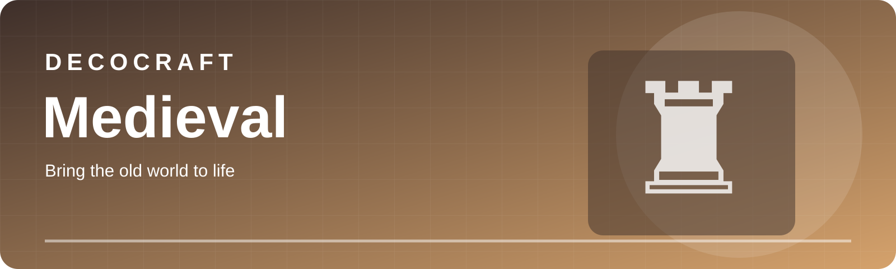](../packs/medieval.md)

**Medieval** — Bring the old world to life

[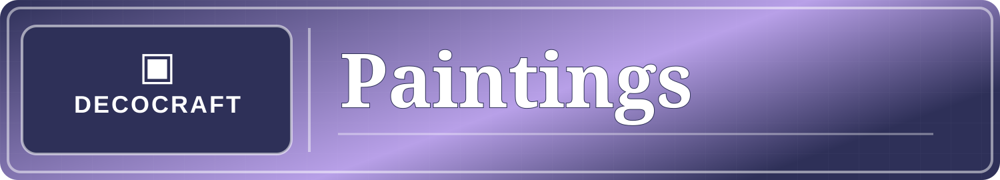](../packs/paintings.md)

**Paintings** — Art to make a house a home

[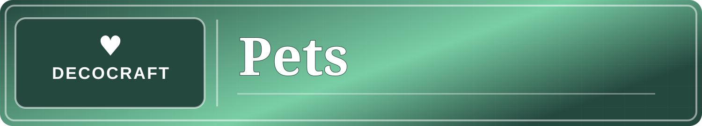](../packs/pets.md)

**Pets** — Perfect spaces for animal companions

[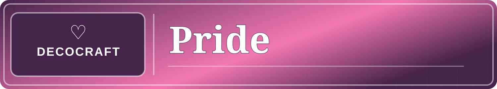](../packs/pride.md)

**Pride** — Colorful ways to express yourself

[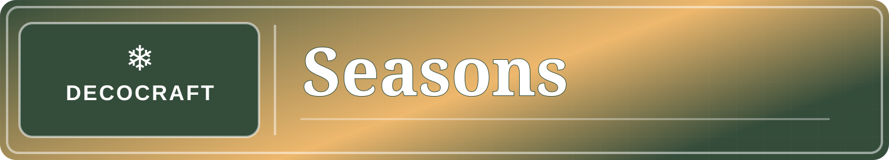](../packs/seasons.md)

**Seasons** — Every season has its charm

[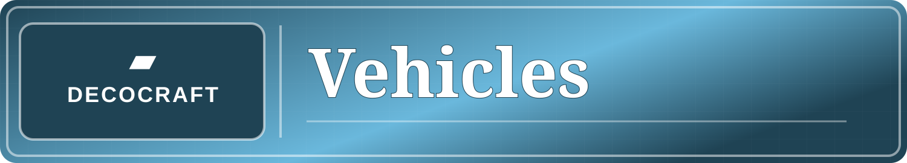](../packs/vehicles.md)

**Vehicles** — Make roads and garages come alive

[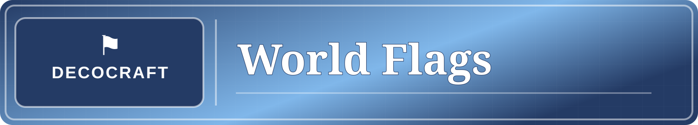](../packs/world-flags.md)

**World Flags** — Celebrate the world in your builds

## Installation and compatibility

Release files for older Decocraft versions may differ from these upcoming modular packs. Check the exact Minecraft version, loader, core dependency, and additional requirements on each published pack page.

[Decocraft on Modrinth](https://modrinth.com/mod/decocraft) · [Decocraft on CurseForge](https://www.curseforge.com/minecraft/mc-mods/decocraft)

**Publishing note:** GitHub-relative image and page links must be changed to public image URLs and actual storefront pack URLs before use on Modrinth or CurseForge.
