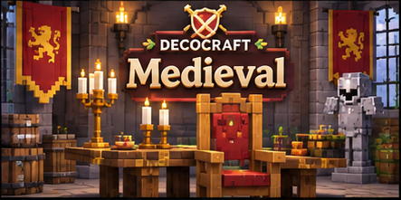

<!-- DRAFT: Verify content, version support, dependencies and final URLs before publishing. -->

# Decocraft: Medieval

> Bring the old world to life

## Description

Make castles, halls, taverns, and historic villages feel richly furnished. Combine this theme with other modular Decocraft packs to give your Minecraft creations the finishing touches they deserve.

## Technical Information

| Requirement | Details |
| --- | --- |
| Minecraft version(s) | **TBD — verify for this release** |
| Mod loader(s) | **TBD — verify for this release** |
| Core/base dependency | **TBD — confirm required mod and version** |
| Additional dependencies | **TBD — verify complete dependency list** |
| Client/server requirements | **TBD — confirm from build** |
| Pack release version | **TBD** |

**Installation:** Select a file compatible with your Minecraft version and loader, and install the dependencies identified on its release page. Multiplayer installations must also satisfy the server's mod requirements.

## Explore more Decocraft

[Visit the main Decocraft hub](https://modrinth.com/mod/decocraft) to browse all themed packs.

*Draft storefront text. Social links must be replaced and dependencies verified before publishing.*
